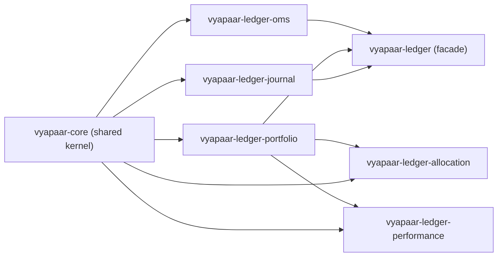

# `vyapaar-ledger` — DDD Architecture & Pure Domain Heart

## 1. Bounded Context & Responsibility

`vyapaar-ledger` (Tier 1B, ported and refactored from `honba-kokoro`) is the
**Zero-I/O Domain Heart**: it owns the post-risk order lifecycle (OMS state
machine), FIFO tax-lot & T+1 Demat settlement accounting (portfolio), double-entry
bookkeeping and Indian statutory taxes (journal), portfolio target-weight
allocation (allocation), and the trader's performance/annotations journal
(performance).

The crate is a pure, synchronous domain library: no network sockets, no
filesystem I/O, no database drivers, no async runtime (`tokio`), and no wall-clock
queries. Every state transition accepts an explicit `DateTime<Utc>` (or
`NaiveDate`) from the caller, so replaying identical timestamped events produces
byte-for-byte identical state. All prices, quantities, cash, PnL, and taxes use
exact `rust_decimal::Decimal` arithmetic — zero `f32`/`f64` in any financial path.

## 2. Workspace Topology (6 crates)

| Crate | Aggregate Root / Domain Service | Responsibility |
| :--- | :--- | :--- |
| `vyapaar-ledger-oms` | `OrderStateMachine` / `OrderEntry` | Deterministic SEBI order lifecycle FSM (`PendingNew` → `New` → `PartiallyFilled` → `Filled` / `Cancelled` / `Rejected` / `Expired`), `ClientOrderId` idempotency, target-vs-cumulative fill reconciliation, plus the OMS context canvas (`OmsConfig`, `MarketData`, `PortfolioRiskState`, `OmsSnapshot`). |
| `vyapaar-ledger-portfolio` | `AccountState` / `PortfolioState` | FIFO tax-lot matching (`TaxLot`, `MatchedLot`, `LotFill`), realized & unrealized MTM PnL (`HeldPosition`, `Marks`, `value`), Indian corporate actions (`Split`, `Bonus`, `Dividend`, `Demerger`), ICCL T+1 Demat rolling settlement (`ClearingCalendar`, `DematHoldings`, `SettlementEngine`, `settle_trades`), and capital-gains / tax summaries. |
| `vyapaar-ledger-journal` | `DoubleEntryLedger` / `TaxCalculator` | Immutable double-entry general ledger (`sum(Debits) == sum(Credits)`), the Indian chart of accounts (`AccountCode`), statutory charge calculation (`TaxBreakdown`, `compute_charges`), and the broker contract-note golden framework (`contract_notes`). |
| `vyapaar-ledger-allocation` | `PortfolioState` (adapter) / `TargetWeights` | Pure portfolio allocation: `optimize()` for `AllocationObjective::{MeanVariance, RiskParity}` under `Constraint::WeightBounds`, exact `Decimal` linear algebra (Gaussian elimination, fixed-point risk parity). |
| `vyapaar-ledger-performance` | `JournalStore` / `ClosedTrade` | Trader's performance journal: annotations (`TradeAnnotation`), day-keyed notes, `PerformanceMetrics` + composite `EdgeScore`, daily P&L calendar (`PnlCalendar`), and account comparison. Thin layer over `vyapaar-ledger-portfolio` FIFO matches. |
| `vyapaar-ledger` | Repository traits & facade | Re-exports `oms`, `portfolio`, `journal`, pure domain repository traits (`OrderRepository`, `AccountRepository`, `PositionRepository`, `LedgerRepository`) with in-memory reference implementations, and the risk-aware sizing hook (`Portfolio`, `evaluate_risk_budget`). |

### Dependency graph



Every crate depends only on `vyapaar-core` and (for `allocation` and
`performance`) on `vyapaar-ledger-portfolio`; `allocation` and `performance`
are siblings of the facade and are **not** re-exported through it.

## 3. Architectural Invariants

1. **Zero-I/O & zero-tokio**: no `async`/`await`, no `tokio`, no `std::fs`, no
   network, no database drivers in any crate.
2. **Temporal determinism**: no `SystemTime::now()` / `Instant::now()` /
   `Utc::now()` in domain logic. Every entry point takes the time from the
   caller. (One known violation is tracked as
   [`docs/gaps/0005-performance-metrics-clock-query.md`](../gaps/0005-performance-metrics-clock-query.md).)
3. **Zero floats**: `rust_decimal::Decimal` everywhere money/price/quantity/tax
   is computed; matrix inversion, risk-parity fixed point, and bound projection
   in `vyapaar-ledger-allocation` all run in exact `Decimal`.
4. **DDD aggregates own their rules**: FIFO matching lives on
   `AccountState::match_lots`; balance validation lives on
   `JournalTransaction::validate` / `DoubleEntryLedger::post`; the lifecycle
   graph lives on `OrderStateMachine::transition`. Repositories only adapt and
   project.
5. **Dependency inversion**: the domain crate owns repository traits;
   in-memory implementations are the reference mocks for simulation and tests.
6. **WASM targetable**: portfolio, journal, and allocation math contain no
   blocking OS primitives and compile for `wasm32-unknown-unknown`.

## 4. Role in the Event Pipeline

`vyapaar-ledger` sits downstream of the risk gate: after
`vyapaar-risk` releases an `OrderEvent`, the OMS (`vyapaar-ledger-oms`) owns the
order lifecycle, `FillReport`s feed FIFO tax-lot matching (`vyapaar-ledger-portfolio`),
and every cash/securities movement is journaled by the double-entry ledger
(`vyapaar-ledger-journal`). `allocation` and `performance` are read-side /
research engines that consume portfolio state but never place an order.

## 5. Test Layout & Verification

All tests live in `tests/` parallel to `src/` (no inline `#[cfg(test)]` in
production files). The workspace verifies with:

```bash
make prod     # cargo build --workspace --profile prod
make test     # cargo test --workspace --profile prod
make check    # cargo check --workspace --profile prod
make clippy   # cargo clippy --workspace --all-targets --profile prod -- -D warnings
make fmt      # cargo fmt
```

See [`implementation-record.md`](implementation-record.md) for the migration and
landing history, [`code-migration-map.md`](code-migration-map.md) for the
`honba-kokoro → vyapaar-ledger` file mapping, and the per-module references
(`code-oms.md`, `code-portfolio.md`, `code-journal.md`, `code-contract-notes.md`,
`code-repository.md`, `code-sizing.md`, `code-allocation.md`,
`code-performance.md`) for API-level detail.
